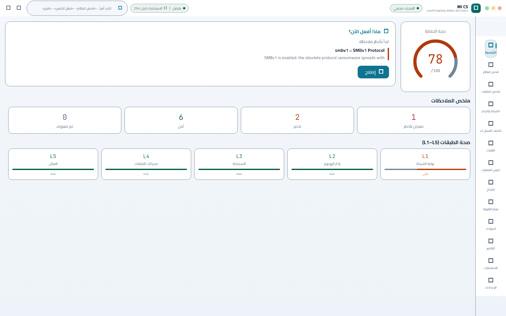
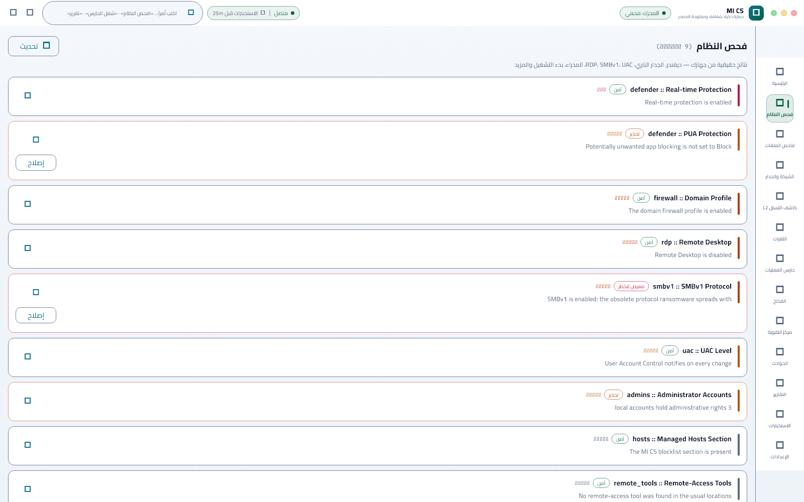
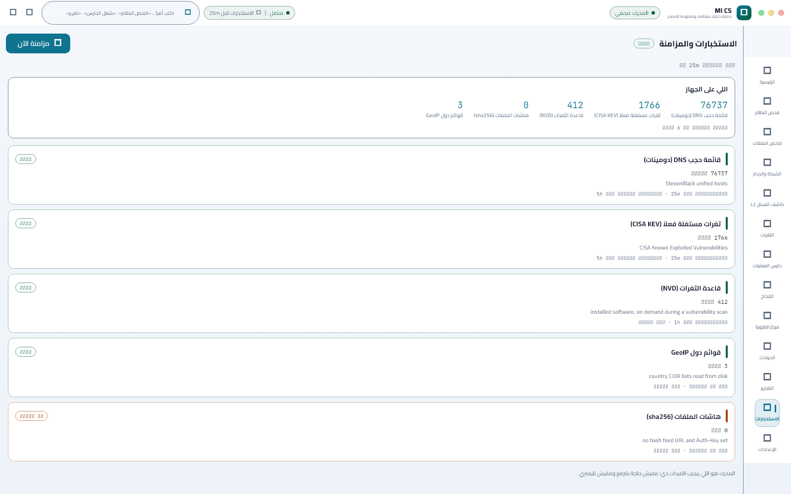
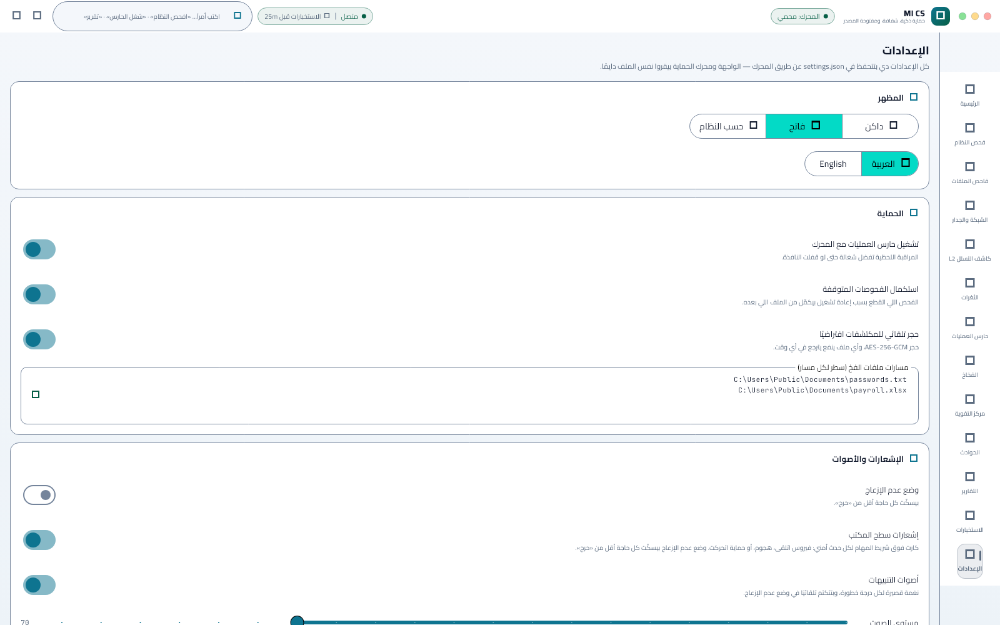

# 🛡️ MI CS — Mourad Ibrahim Cyber Security

**Smart. Transparent. Open-source defense.** · **حماية ذكية، شفافة، ومفتوحة المصدر**

MI CS is a free, open-source cybersecurity command center for Windows: a
multi-layer defense wall, malware scanner, real-time process monitor,
vulnerability scanner and hardening center — with an interface that prioritises,
explains, and suggests the next action instead of dumping raw data.

> **Status: `v0.1.0` is published, and the signature is the only thing the release
> page lacks.** Every feature below is
> implemented and covered by tests, the portable package and its installer are built
> and verified, and the package carries a signed manifest of itself that the app
> checks at start-up (see *Is this copy the published one?*). The first build,
> `v0.1.0`, was built and verified by the
> [Release workflow](.github/workflows/release.yml) and the owner **published it on
> 2026-11-10** — four assets, and the hashes of three of them were re-checked against
> the published `SHA256SUMS` on 2026-11-11, and the portable package against its own
> signed manifest ([Download](#download) has the numbers and how to repeat them).
> What is *not* in that download is anything that landed after it was built on
> 2026-11-05 14:18:45 — the default update feed (D-046), the manifest's signing
> (D-047), the two language decisions (D-049, D-050) and the update pin (D-051) are
> in `main` and will be in the next release. The acceptance run that needed a human **ran on 2026-11-07**: the per-machine
> installer was taken through install → helper creation → a privileged operation with
> no prompt → uninstall, one UAC prompt each, with the product, the service and the
> shortcuts all gone afterwards and the state folder kept on purpose. Two things are
> still missing: a **publicly trusted signature** — which is **not** a purchase and will
> not become one, and which now has two free routes on record
> ([`docs/SIGNING.md`](docs/SIGNING.md): the Microsoft Store re-signs an MSIX package for
> free and that route is open today; OSSign issues the project a certificate once the
> repository is six months old, ~2027-04-27) — and a download
> for Windows on ARM. This is a free,
> open-source project with no budget, so the trust story is also what a reader can check
> without trusting anybody: the manifest inside the engine, the hashes beside the
> archive, and a build they can reproduce (see
> [What MI CS does not do](#what-mi-cs-does-not-do), D-035 and D-036). The release wiring
> already accepts a certificate the day one exists — donated, or from a free route —
> with no code change (D-034). The
> ARM64 engine builds, and GitHub's `windows-11-arm` runner runs its tests natively;
> the ARM64 *app* download is a different question, because Flutter publishes no
> Windows ARM64 SDK (0 of the 747 archives it lists mention arm64, measured
> 2026-11-04) — the release workflow asks that runner for the x64 SDK and marks
> both ARM64 jobs informational until they have a green run — see *Requirements*).
> What is left is short and entirely free: a publicly trusted certificate (ب5 — the Store
> account or OSSign; **هـ1** is done,
> the update manifest's URL, its signature and the thumbprint pin all landed on
> 2026-11-09, D-046/D-047, and the pin that signature is judged against became the
> certificate the engine itself carries on 2026-11-11, D-051 — so a CA-signed
> release recognises itself and a same-name certificate from somebody else is
> refused; the pin does assume the release is signed by **one** identity, which the
> release lane does not do yet — D-051 and the register row it created in
> [`docs/TODO.md`](docs/TODO.md) §7), the engine manifest's signed hashes,
> and the register rows — priorities and estimates in
> [`docs/ROADMAP.md`](docs/ROADMAP.md), and the one-table answer in
> [`docs/TODO.md`](docs/TODO.md) §0.6 — plus one engineering row the
> 2026-11-11 verification of the published release created: `v0.1.0` was signed by a
> certificate minted for that build, so a release lane that keeps minting a fresh one
> would have each engine refusing the next release's payload. Live status:
> [`docs/TODO.md`](docs/TODO.md). Design decisions:
> [`docs/DECISIONS.md`](docs/DECISIONS.md). What is waiting on an
> answer: [`docs/OPEN-DECISIONS.md`](docs/OPEN-DECISIONS.md).

---

## Download

**The download is live**, on the [Releases page](https://github.com/ibraimfarag/MIF/releases/tag/v0.1.0):
`v0.1.0` was built and verified by the
[Release workflow](.github/workflows/release.yml) on GitHub's own runners — never on a
developer machine — and its four assets were published on 2026-11-10 (D-031: the build
and the publish are separate steps, and the publish itself stays a human action, because the
builds are not signed by a publicly trusted certificate (D-035, D-036) and a warning should not be
delivered to strangers by a robot):

| File | What it is | Measured 2026-11-11 |
|---|---|---|
| `MICS-setup-0.1.0-x64.exe` | The installer: one UAC prompt, Start-Menu and desktop shortcuts, an entry in Apps & features, an uninstaller — and the privileged helper. **Recommended.** | 16,642,682 bytes, SHA-256 `5cd206db…f84f5`, **not signed** (see below) |
| `MICS-portable-0.1.0-x64.zip` | The portable package: unpack it into a folder of your own and run `mics_app.exe`. Nothing registered, nothing to uninstall. Not inside a web root — the engine will not start from a Low-integrity folder ([why](#troubleshooting)). | 23,111,206 bytes, SHA-256 `1eafe3ee…fe6b0`, 69 files |
| `SHA256SUMS` | The SHA-256 of exactly the files above, written by the run that built them. | re-checked: all three hashes match the downloaded bytes |
| `report.md` | The QA report of that same run. | SHA-256 `8bc5fab2…846a16` |

The portable package also holds to its own manifest: pointed at the unpacked download,
`scripts\verify-manifest.ps1` reports `PASS - all 67 listed file(s) hash as the signed manifest
says`, and the engine inside it is signed by `CN=MI CS Code Signing, O=Mourad Ibrahim (MI CS)`
(thumbprint `E04CE197…531C3CF5`, issued 2026-11-04). The **installer carries no signature at
all** — `Get-AuthenticodeSignature` says `NotSigned`, which is why the *SHA256SUMS* line, not a
publisher name, is what to check on the file you actually run; signing the installer is part of
what the certificate route (D-036) adds.

Check what you downloaded before you run it:

```powershell
Get-FileHash .\MICS-setup-0.1.0-x64.exe -Algorithm SHA256
```

The hash it prints has to be the hash `SHA256SUMS` lists for that file. Both were produced in
the same run that built the bytes, so they also tell you the download arrived whole. To build
from source instead, the same three commands the workflow runs are in
[Building from source](#building-from-source).

**Windows will say "Unknown publisher", and SmartScreen may warn.** That is expected, not a
sign of a bad download: the engine and the app inside the package carry the project's own
signature and a signed manifest of every shipped file (which the app checks at start-up), but
no *publicly trusted* certificate
and therefore no public reputation. The installer you double-click carries no signature at
all, so the published hashes are its only anchor. This project does not buy one (D-035), and two free
routes for it are now on record (D-036, [`docs/SIGNING.md`](docs/SIGNING.md)): the Microsoft
Store re-signs an MSIX package for free after certification — available today, the work is
packaging, and the shape submitted first installs with no administrator at all (D-038) —
and OSSign issues a project-level certificate once the repository is six months
old (~2027-04-27). Neither is in place yet, so the warning stands for now; the checks that
replace it are the manifest, the published hashes and the build
log. The run-anyway, hash-check and `Unblock-File` steps are in
[Troubleshooting](#troubleshooting). GitHub also marks such a build as an unsigned binary on
the release page; that label is the same missing certificate, not a missing file.

## What MI CS does

| Area | What you actually get |
|---|---|
| **System audit** | Real checks: Defender status, firewall profiles, RDP, SMBv1, UAC + secure desktop, local administrators, startup entries, non-Microsoft scheduled tasks, hosts file, remote-access tools. Returns a 0–100 score with the highest-impact finding first and a one-click fix where one exists. |
| **Malware scanner** | Triage-ordered scan (location × extension × size × age): SHA-256 against a local IOC cache first, then YARA rules. Runs as a **durable job** — if the engine restarts mid-scan it resumes at the exact next file, and the UI shows live progress. A **scheduled scan** is one switch away (Settings → Protection): off by default, then every 6/12/24/72/168 hours over the folder you name (empty = your profile folder). It needs the engine running, and the engine's life is the app's (D-039) — so a scheduled scan fires while MI CS is open, or after the window is closed if you turned on *Keep running in the background* (Settings → Protection) or an engine autostart entry owns it — and it is **report-only**: nobody chose a file while it ran, so it records, alerts and leaves the file for you to act on. |
| **Quarantine** | Detections are encrypted with AES-256-GCM; the master key is protected with DPAPI. Files can be restored or deleted from the app. |
| **Process guard (L3)** | Watches process creation against Sigma-like JSON rules (`rules/guard/*.json`, hot-reloaded). Alerts, optional kill-tree response, canary (decoy) files that raise a CRITICAL alert when touched, an incident correlator that groups related events into one kill-chain timeline, and a noise learner that offers to mute what you keep dismissing. |
| **Network monitor** | Live TCP/UDP connections with owning process, plus a firewall manager: default-deny outbound toggle and every rule MI CS creates is prefixed `MICS-`. Country blocking works from a locally synced CIDR list. |
| **IDS (L2, minimal)** | Domain blocklist enforced through a managed section of the hosts file, so every application on the machine is blocked from those domains. |
| **Vulnerability scanner** | Matches installed software against the NVD database (API 2.0), with an offline cache and honest "from cache" labelling. Runs as a cancellable job with live progress, and flags CVEs that CISA lists as **exploited in the wild** (KEV badge with the remediation date). |
| **Intelligence** | One card per intel source (DNS blocklist, CISA KEV, file hashes, country lists, NVD) with its own state, count, next attempt and last error, plus what the machine actually holds. Sources that need a URL or key say so instead of silently staying empty. |
| **Hardening center** | Five one-click fixes (Defender PUA protection, SMBv1 off, RDP off, UAC + secure desktop, Defender quick scan). Every change takes a snapshot first and can be rolled back. |
| **Reports** | One-click Markdown security report (score, findings, startup entries, incident kill-chains) written to `Documents\MICS-Reports\`. |
| **Notifications** | A desktop card above the taskbar for **every** security event: a file the scanner catches (with a working **Quarantine** button), a suspicious process, a canary touch, or a protection action (default-deny, country block, hosts blocklist update). Cards fire while MI CS is running — with *Keep running in the background* on, that includes the window being closed — speak the app language (AR/EN), and follow one policy: CRITICAL/HIGH/MEDIUM become cards, LOW stays in the app, do-not-disturb keeps only CRITICAL, and a switch turns cards off entirely. In-house notification sounds with volume and mute are separate. |
| **Privileged helper** | Admin work (firewall, hosts file, hardening) goes through one LocalSystem service installed with a **single** UAC prompt instead of one per action. The operation set is closed and documented (`docs/PRIVILEGED-OPS.md`), every call is audited before and after it runs, and an unelevated helper refuses instead of half-applying. |
| **Is this copy the published one?** | The package describes itself: a SHA-256 manifest of the **68** files it ships is carried **inside `mics-engine.exe`**, written there before the engine gets its own Authenticode signature, so the manifest is only as trustworthy as the signature over it. At start-up the engine re-reads that document out of its own image, re-hashes the folder it runs from, and reports the verdict through `status.integrity`: `ok`, `untrusted-certificate` (our certificate, a root this Windows has not trusted yet) or `unverified`. **Settings → About** shows one line for all three, the log always names the first file that changed, and a card names it when the copy carries a document that disagrees. Delete a byte, swap a DLL, edit the document: the app says which file, and the release gate refuses the folder. |
| **Languages** | Arabic and English, complete, with full RTL layout. Language packs are per-module files; adding a language is one folder, one `assets:` entry and one line. The engine stores the tag you pick rather than a name it knows, so a pack can arrive without an engine release — and a tag no pack answers to renders **English** with one line in Settings naming it, instead of an Arabic frame with English gaps (D-049). The other way round, a bundled language whose pack loaded nothing logs one line and names that language in Settings rather than rendering its keys raw and silently (D-050). |

**Architecture in one line:** a Flutter UI talks JSON-RPC 2.0 over the named pipe
`\\.\pipe\mics_engine` to a single Rust engine (`mics-engine.exe`), which owns
every OS call. The UI never touches system APIs.

Two different kinds of name, on purpose. **In Task Manager** the two halves are
listed as **MI Cyber Security** (the app) and **MiShild Background** (the engine),
and both wear the **same icon** — those strings and that icon come from each
executable's version resource, so the files are still `mics_app.exe` and
`mics-engine.exe` (the names every script, the app's engine lookup and
`MICS_ENGINE_PATH` use). Right-click → *Properties* → *Details* shows the same
thing; the *Details* tab of Task Manager always shows the file name.

**Inside the product** the name is **MI CS**: the window title, the title bar, the
tray tooltip and the header of every notification card. The desktop shortcut is
**MICS** and the Start-Menu shortcut is **MI CS** (both settled — D-020); they take
their icon from `mics_app.exe`, so the desktop, the taskbar, Alt-Tab, Explorer and
the engine's Task Manager row all show one icon. The `MICS-*` firewall rule prefix
and the `MICS_*` test hooks are identifiers and keep their spelling.

## What MI CS does **not** do

Honesty is a feature. Today, MI CS does **not**:

- install a **kernel driver** or filter network traffic inline — it is a usermode
  product and cannot see traffic before the OS does;
- ship **ClamAV**, **CAPA** or a **Suricata/ET-Open** IDS engine; L4 is IOC
  hashes + YARA, and L2 is a hosts-file domain blocklist (documented as
  "minimal mode");
- detect a touch on a canary file **that Windows did not record**. Decoys are polled
  for mtime/size — so writes, renames and deletes are caught — and for the file's
  **last-access time**, so a read-only open is its own HIGH `canary_read` event
  (D-032). The honest limit is the other direction: a volume that keeps no atime
  cannot show a read, so the engine **probes the volume and reports the range** it
  actually has instead of assuming it, and a decoy MI CS has just written stays
  quiet for 90 s because the first thing to open a new file on Windows is usually
  Defender or the indexer;
- hash a **process as it starts**: the guard matches process creation against
  JSON rules, and it does not read the image's SHA-256 — hashing every process
  start was judged too hot — so a known-bad hash that matches no rule is caught
  by a **scan**, not at start. That is a deliberate limit and the guard reports it
  as a fact (`ioc.hash_checked_at_process_start` in `guard.status`) instead of
  leaving it to a comment (D-048, `docs/PROTECTION-MATRIX.md` §4.1);
- watch files **as they change**: a scheduled scan walks the folder you named
  every few hours (and only while the engine is running — the engine starts with
  MI CS and, by default, ends when you close it, D-039), so a file that appears
  and is deleted between two runs is never seen.
  Continuous watching (`ReadDirectoryChangesW`/USN) is the other half of that
  layer and is a decision to take, not a detail to slip in
  (`docs/PROTECTION-MATRIX.md` §2);
- send anything to **VirusTotal**: there is no client and no key to enter, so no
  file — not even a hash — is ever looked up there. File reputation is local
  (IOC hash cache + YARA) only;
- promise that an update is signed by *us* and not just by *someone*: the payload
  must carry an embedded Authenticode signature that Windows trusts
  (`docs/THREAT-MODEL.md` F-3). That check pins the **certificate over this very
  engine** whenever the build has one — its own thumbprint, read out of the file
  itself, or `MICS_UPDATE_SIGNER_THUMBPRINT` — and drops to the release name
  `CN=MI CS Code Signing` only for a build with no signature of its own, which
  reports itself as `pinned: false` rather than calling that a pin (D-051). The
  name alone could not have survived a real certificate — CSCBR §9.2.2 requires
  the subject CN to be the verified legal name, so **no CA can ever issue
  `CN=MI CS Code Signing`** (measured 2026-11-06, `docs/COST.md` §2) — which is
  why the pin moved **before** ب5 rather than with it: the first CA-signed release
  used to refuse itself at the payload check (`engine/src/update.rs`, D-016);
- what is *not* pinned, stated plainly: the pin comes out of the file under
  question, so a copied install that somebody re-signed carries its own
  certificate and pins that (`docs/THREAT-MODEL.md` F-3). On the update path the
  payload is a different file from the engine judging it, and there the pin has
  teeth;
- guarantee that "fix" buttons work without administrator rights: firewall,
  hosts-file and hardening changes are privileged. The app installs its
  **privileged helper** with one Windows prompt the first time you use such a
  fix, and never asks again (see `docs/PRIVILEGED-OPS.md`);
- hide the fact that **these binaries show "Unknown publisher"** in Windows dialogs
  and may raise a SmartScreen warning. That is a publicly trusted Authenticode
  certificate, and this project does not buy one: it is free and open-source with no
  budget (D-035). What it does instead is make the copy *checkable* — the signed
  manifest inside `mics-engine.exe`, the `SHA256SUMS` published beside the archive,
  and the workflow log that produced both. Two free routes for that certificate are
  on record in [`docs/SIGNING.md`](docs/SIGNING.md) (D-036) — the Microsoft Store
  re-signing an MSIX, and OSSign at ~2027-04-27 — and the release wiring already
  takes a certificate the day one is donated (two repository secrets, D-034), so no
  code changes when one arrives;
- prevent a **repackager who has their own certificate**: the manifest makes a
  changed copy *visible*, not *impossible*. If somebody rebuilds `mics-engine.exe`,
  keeps the document in step and signs it with their own certificate, the app says
  `unverified` and names why — it cannot refuse to run, because MI CS is the thing
  that would be doing the refusing. The other direction is now checkable too: the
  build is **reproducible** ([`docs/REPRODUCIBLE.md`](docs/REPRODUCIBLE.md)) —
  `make-release.ps1 -Reproducible` takes the build time from the revision instead of
  the clock and asks both linkers for `/Brepro`, and
  `scripts\verify-reproducible.ps1 -Reference <the published zip>` rebuilds from
  source and compares every file, on the unsigned content hash where a signature is
  involved. Two documented exceptions remain, both measured and named by that
  script rather than waved through: the Authenticode blobs themselves, and
  `mics-engine.exe`, whose embedded `MICS_MANIFEST` records the hashes of the files
  *as signed* (`docs/THREAT-MODEL.md`, F-11). What *is* proved:
  both binaries carry **Control Flow Guard**, ASLR/DEP/high-entropy VA and no
  symbols or PDB paths, the Dart snapshot ships obfuscated (D-021), and
  `scripts\verify-hardening.ps1` reads all of it back out of the PE while the
  release refuses to skip it;
- claim **idle CPU below the 1 % budget**: with the shipped six-rule pack actually
  loaded, the guard loop costs **0.156–0.521 % of one core over four 60 s windows,
  median 0.417 % = 0.0028–0.0093 % of a 56-thread machine, median 0.0074 %**
  (`scripts/measure-guard-cpu.ps1 -RealRules`, guard on versus `MICS_NO_GUARD=1`,
  with the guard-off half below the process timer's resolution), so the budget holds
  whether it is read per core or per machine — and it did not before: 3.52 % of a
  core until the poll loop was trimmed,
  and the "2.97 %" quoted earlier came from a benchmark that was mostly measuring its
  own probe (`mics-engine benchmark` now reports its own `GetProcessTimes`, with
  `cpu_percent` and `cpu_percent_of_machine`). RAM is ~12 MB, inside budget.

## Screenshots

The light theme, in Arabic (the app's default language), rendered from the app's
own widgets with **canned engine data**:

| Dashboard | Audit |
|---|---|
|  |  |

| Intelligence | Settings |
|---|---|
|  |  |

These are **renders, not a capture of a real machine**: the score (78), the nine
findings and the three synced sources are sample data, and the images exist to show
the interface, not to prove it works. What proves it is the text around them — the
tests, the receipts in `docs/`, and `scripts\verify-*.ps1`. Regenerate any time
(the harness fails if a screen renders empty, if a font is missing, or if an image
comes out dark):

```powershell
flutter test --no-pub tool\write_screenshots_test.dart
```

## Requirements

| | |
|---|---|
| **OS** | Windows 10 21H2+ or Windows 11 (x64) — that is the only download today. **Windows on ARM**: the engine compiles and links for ARM64 (`scripts\build-engine-arm64.ps1`, artifact checked as a hardened ARM64 PE) and GitHub's `windows-11-arm` runner **runs the engine's own tests natively**, but the Flutter app has no Windows ARM64 toolchain: the SDK is published for x64 only (0 of the 747 archives in Flutter's `releases_windows.json` mention arm64, measured 2026-11-04), and `flutter build windows` takes its target from the host platform. The release workflow now asks that runner for the x64 SDK (run under emulation) and keeps both ARM64 jobs informational until they have a green run — so an ARM64 download does not exist yet (D-003 and its 2026-11-04 correction). 32-bit Windows: not supported — Flutter has no 32-bit Windows desktop target. |
| **CPU / RAM** | 4 cores / 8 GB. The engine idles at **~12 MB RAM** (measured 12.5 MB), against a **150 MB** budget the engine's own benchmark asserts — the number is enforced, not a wish. |
| **Disk** | **~52 MB** for the unpacked package (70 files, 51.9 MB measured 2026-11-07; the archive is 21.5 MB and the installer 16 MB), plus whatever the quarantine and intel cache grow to. |
| **Privileges** | none to start: the app runs unelevated. The first firewall/hosts/hardening fix asks **once** to install MI CS's privileged helper (a LocalSystem service); after that, privileged actions need no prompt. |
| **Network** | optional. Everything core works offline; the network is used only for intel sync, NVD lookups and a local LM Studio instance (if you run one). |

## Install and first run

Today MI CS ships as a **portable folder and a portable archive**, and as an
**installer** (`MICS-setup-<version>-x64.exe`, built with NSIS from the same
package — one UAC prompt, a Start-Menu entry, a desktop icon, an entry in Apps &
features, and an uninstaller). Both are published for `v0.1.0`
([Download](#download)); to build one from this tree instead, use
[Building from source](#building-from-source) — the steps below are the same either
way. Pick one:

**Installer (recommended).** Run `MICS-setup-<version>-x64.exe` and click through
one UAC prompt. It installs for every user under `%ProgramFiles%\MI CS`, creates the
Start-Menu entry, the desktop icon, the Apps & features entry and the AUMID Windows
labels notification cards with — the registry key *and* the shortcut's
`System.AppUserModel.ID`, so the Shell files the app under `MI CS` rather than under
the exe path. That one prompt also installs the **privileged helper** (the engine's
own `install-helper`, so the service definition lives in one place), which is why a
fix that needs administrator rights never asks a second time; if the service cannot
be created the install still completes, says so in its details, and the app asks once
later instead. `Uninstall MI CS` removes the lot — the helper included.

**Portable.** Nothing registered, nothing to uninstall: take
`MICS-portable-<version>-x64.zip`, or the already-unpacked `dist\MICS-portable`
folder, and put it almost anywhere (the installed location, `%LOCALAPPDATA%\MI CS\`,
a USB stick). **Not inside a web root, or any other Low-integrity folder.** Windows
gives a process the integrity label of the folder its image sits in; from a
Low-labelled folder the engine cannot write its state database or reach the
privileged helper, so it refuses to start — and because this app starts it detached,
that refusal reaches the window as a bare "engine not running". It now names the
folder and the way out instead, and
`scripts\verify-portable-pair.ps1` unpacks the published zip outside the repository
on every release run to prove the pair starts there; see
[Troubleshooting](#troubleshooting).
`dist\SHA256SUMS` lists the SHA-256 of the zip and of the files inside it, so a
single extracted file can be checked too. If MI CS is running from the unpacked
folder, `make-release.ps1` leaves it alone rather than deleting files in use — the
zip is the release.

Then, either way:

1. Run `mics_app.exe`. Windows may warn about an unknown publisher, or SmartScreen
   may say it **can't reach** its reputation service — the build is not signed by a
   publicly trusted certificate, so there is nothing for it to verify. That is the
   state today, and it is not a pending purchase: a certificate is the one thing MI
   CS does not buy (D-035). Two free routes exist for it (D-036,
   [`docs/SIGNING.md`](docs/SIGNING.md)) and neither is in place yet, so for now the
   [manifest check in step 4](#install-and-first-run) is what you check instead. The
   [Troubleshooting](#troubleshooting) table has the run-anyway, hash-check and
   `Unblock-File` steps.
2. The app starts the engine automatically, runs a first audit (~10 s) and shows
   your score with the single most valuable fix to make.
3. The first privileged fix asks once to install the helper
   (`Settings → Engine → Install helper` also does it explicitly); the card then
   shows **ready** and no later action prompts again.
4. Open **Settings → About** and read the integrity line: on an untouched copy it
   says the shipped files are the ones the package describes. If it says
   `unverified` instead, the folder no longer matches the manifest inside
   `mics-engine.exe` — the same check runs headless, so you can ask it before the
   app ever starts:

   ```powershell
   powershell -ExecutionPolicy Bypass -File scripts\verify-manifest.ps1 -Path "C:\path\to\MICS-portable"
   ```

   It re-reads the manifest out of the engine's image, re-hashes every file it
   lists, and refuses the folder (exit 1) with the file that changed. It is the
   same check `make-release.ps1` runs before anything is packaged, and it also
   refuses an engine whose signature is not ours.

The engine log says which rule file it loaded (`rules\yara\starter.yar` and
`rules\guard\starter.json` next to the binaries, hot-reloaded): if it ever says
"built-in starter pack" instead, the copy is incomplete — `rules\` is missing.

**Uninstall:** remove the program — installed copies go through `Uninstall MI CS`
(Start Menu) or Apps & features, portable copies are just the folder. The installed
one does the helper for you: the same elevated run that created `MICSHelper` stops and
deletes it, and only after checking that the service really is *this* copy's (`sc`
delete is scoped to the service name the installer recorded, so a helper pointing at
another copy is left alone). If it cannot — an uninstall started without
administrator rights, a helper definition it cannot read — **nothing is removed** and
it tells you to use `Settings → Engine → Remove helper` (one prompt) first, then run
it again. On a portable copy that step is yours either way, because nothing there
installed the service. Either way the data folder below stays until you delete it
yourself. The only other registry entries MI CS creates are the installer's own
(shortcuts, the AUMID, the Apps & features entry — all removed with the program) and
an optional `HKCU\...\Run` value (`Settings → Engine → Start with Windows`), removed
by the same screen.

## Where your data lives

| What | Location |
|---|---|
| State (database, settings, logs, quarantine, synced blocklists) | `%PROGRAMDATA%\MICS`, or `%LOCALAPPDATA%\MICS` when the machine-wide folder is not writable by your user. The chosen path is remembered in `%LOCALAPPDATA%\MICS\.data-dir` and printed at engine startup as `data=…`. |
| Settings | `settings.json` in the state folder — read by **both** the UI and the engine so they can never disagree. |
| Engine log | `logs\engine.log`, rotated at 5 MB (a per-process file is used if the main log is not writable). |
| Quarantine | `Quarantine\` — AES-256-GCM blobs, master key protected with DPAPI. |
| Reports | `Documents\MICS-Reports\` |
| Canary decoys | `Documents` and `Desktop` by default; configurable in Settings. |
| Rules | `rules\` next to the executable (YARA + guard JSON), hot-reloaded; the shipped package includes the packs, and the engine logs which file it used. A built-in starter pack is the fallback when that folder is missing. |

Set `MICS_DATA_DIR` to relocate the whole state folder (portable mode).

## Privacy

- **No telemetry, no accounts, no ads.** Nothing about your usage is reported
  anywhere.
- Nothing leaves the machine except what you explicitly trigger: intel sync
  (public IOC feeds), NVD queries and a local LM Studio instance on `127.0.0.1`
  (only if you run one).
- State is local SQLite plus plain files you can inspect and delete.

## The five layers

| Layer | Implemented as | Protects against | Does not cover |
|---|---|---|---|
| **L1 Network Gate** | Windows Firewall through its own API: default-deny outbound, `MICS-*` rules, per-country CIDR blocking | Unwanted outbound traffic and known-bad ranges, once rules exist | No deep packet inspection — it is policy, not an inline filter |
| **L2 Attack Radar** | Managed hosts-file domain blocklist + GeoIP tables from synced blocklists | Name resolution to known malicious/tracking domains, for every app | Raw-IP traffic, DoH inside apps, no packet inspection |
| **L3 Response** | Process guard (2 s poll unelevated, kernel ETW when elevated), Sigma-like rules, kill-tree, canaries, incident correlator | Suspicious process creation, persistence attempts, ransomware-style decoy touches | Not a kernel driver; an attacker who is already admin is out of scope; a process **image is not hash-checked at start** — rules match name/parent/command line, and a scan owns the hash dimension (D-048) |
| **L4 File Engines** | Triage scanner: SHA-256 vs local IOC cache, then YARA rules | Known-bad files by hash and by pattern | No ClamAV signatures, no CAPA, no unpacking |
| **L5 Mind** | Incident correlation (kill-chain timeline) + assistant: built-in AR/EN templates, optionally a **local** LLM (LM Studio) | Alert fatigue — related events become one incident with a story | The command bar is rule-based (regex intents), not an LLM planner |

The same layers, with what each one actually **sees, detects, blocks and misses** —
layer by layer, with the code file behind every claim and how that claim is
checked — are in [`docs/PROTECTION-MATRIX.md`](docs/PROTECTION-MATRIX.md); the
table above is the short version, and the `L1`–`L5` numbers are the same in both.

## Settings

One screen, eight sections; every field is validated and persisted by the engine:

- **Appearance / language** — dark, light, follow system (live), AR/EN.
- **Protection** — guard autostart, resume interrupted scans, default
  auto-quarantine, **scheduled scan** (off / 6 / 12 / 24 / 72 / 168 hours, and the
  folder it walks — empty means your profile folder), canary paths, and
  **keep running in the background** (close to tray).
- **Notifications & sounds** — desktop cards on/off, do-not-disturb, sounds
  on/off, volume, test toast, test sound.
- **Intelligence & schedule** — refresh interval (1–168 h), NVD key, optional hash
  feed URL and Auth-Key, sync now, live connectivity and freshness.
- **Integrations** — LM Studio URL and model.
- **Updates** — manifest URL, stable/beta channel, check, download and install.
- **Engine** — executable path, connection state, start with Windows, and the
  **privileged helper** card (state, version, install/repair/remove).
- **About** — version, license, tagline, and the **integrity line**: whether the
  files next to the engine are the ones this package describes (see the *What MI CS
  does* table).

**The tray icon** is the way in without the window. A **left click** opens a styled
panel — whether the engine is up, whether the guard is running, the firewall's mode,
how many connections are open, and the switches for the guard, do-not-disturb and
*keep running in the background* — with **Open MI CS** and **Quit** under it, and
`Escape` (or a click anywhere else) to put it away. A **right click** still opens the
plain Windows menu, which is what the panel is built on top of rather than instead of
(D-040). With *keep running in the background* on, closing the window hides MI CS and
leaves the engine protecting; with it off — the default — closing the window stops the
engine with it (D-039).

**Explorer's context menu** carries **Scan with MI CS** on a file, on a folder, and on
the empty space inside a folder — the installer writes that entry for the user who
installed it, and the uninstaller removes it (D-041). Choosing it starts a scan of what
you clicked and shows the result in the scanner screen; if MI CS is already open, the
window that is open comes forward and scans there instead of a second window starting.
A portable or Store copy carries no menu entry, because it is this installer that
writes one.

## Building from source

Prerequisites: **Flutter 3.x** (Windows desktop enabled), **Rust stable** (MSVC
toolchain) and **Visual Studio 2022** with *Desktop development with C++*.

```powershell
# 1) Engine
cd engine
$env:YRX_REGENERATE_MODULES_RS = "false"   # yara-x build script; safe with a read-only cargo registry
cargo build --release

# 2) App
cd ..
flutter pub get
flutter build windows --release

# 3) Assemble the portable release (engine + rules + app + zip + SHA256SUMS)
powershell -ExecutionPolicy Bypass -File scripts\make-release.ps1

# 4) Wrap that exact package in the installer (needs NSIS, no admin to build)
powershell -ExecutionPolicy Bypass -File scripts\make-installer.ps1
```

`MICS_ENGINE_PATH` overrides the engine location if you keep it elsewhere.
`make-release.ps1` first checks that the committed third-party inventory
(`sbom.cdx.json` and `THIRD-PARTY-NOTICES`) still describes the lockfiles, and
ships both in the package; regenerate them with `dart run tool\sbom.dart` after
any dependency change. It then assembles into a staging folder, copies
`engine\rules` next to the binaries (the guard and YARA packs are hot-reloaded
from there — a package without them silently falls back to the compiled-in pack),
refuses to continue if anything required is missing, writes `VERSION`, and
produces `dist\MICS-portable-<version>-x64.zip` plus `dist\SHA256SUMS`. With
`-Sign` it also builds `MICS_MANIFEST` — the SHA-256 of every staged file — injects
it into `mics-engine.exe` as a resource, signs the engine **after** that injection
(so the signature covers the document, D-025), and then re-runs the two probes that
prove it: `verify-manifest.ps1` (the folder is the one the manifest describes) and
`verify-tamper.ps1` (a tampered copy is refused and reported). The
staging build is then swapped into `dist\MICS-portable` — unless MI CS is running
from that folder, in which case it is left untouched and only the zip is
refreshed. Add `-SkipBuild` to repackage without rebuilding the app, or
`-EnginePath <exe>` when cargo builds somewhere else.

`make-installer.ps1` wraps that folder — never a second assembly path — in
`dist\MICS-setup-<version>-x64.exe`: it re-runs `verify-hardening.ps1` on the
binaries first, so an installer cannot ship what the ZIP gate refused, and it finds
NSIS on `PATH`, under `%LOCALAPPDATA%\mics-tools`, or in `Program Files`. Building
needs no elevation; running the per-machine installer needs one UAC prompt.
`-TestUser` builds the same script as a per-user, no-UAC variant (that is how the
install/uninstall path is verified without a human clicking), and `-Out`/`-Makensis`
override the output path and the compiler.

Check what you just produced — hashes, completeness, and that the extracted copy
serves the privileged helper protocol, puts a real card on the desktop, and loads
its **own** rules rather than the fallback:

```powershell
powershell -ExecutionPolicy Bypass -File scripts\verify-release.ps1
```

**Signing (this is what stops the SmartScreen prompt).** Windows blocks an
unsigned binary it has never seen. Sign the package in the same step as the build:

```powershell
# self-signed certificate, trusted on this machine only - no certificate to buy,
# no elevation, and Windows shows the publisher instead of refusing the app
powershell -ExecutionPolicy Bypass -File scripts\make-release.ps1 -Sign

# or with a real certificate for a public release (this also timestamps). A CA-issued
# certificate has to keep its key in hardware, so it is signed through the Windows
# certificate store by thumbprint - a cloud agent (e.g. Certum's SimplySign) or a token
# installed in CurrentUser\My. A .pfx on disk cannot carry a compliant key.
powershell -ExecutionPolicy Bypass -File scripts\make-release.ps1 -Sign `
  -Thumbprint "<the certificate's SHA-1 thumbprint>"
```

`-Sign` signs `mics_app.exe` and the bundled DLLs **before** they are hashed and
zipped, so `SHA256SUMS` describes the signed files — and it signs `mics-engine.exe`
**last**, after `MICS_MANIFEST` has been injected into it, because the signature has
to cover the document that describes the package (D-025). The
self-signed mode creates `CN=MI CS Code Signing` in `Cert:\CurrentUser\My` and
trusts it in `CurrentUser\Root` + `CurrentUser\TrustedPublisher` (neither needs
administrator rights), then verifies every file and fails the release if one does
not come back `Valid`. A self-signed signature is **local trust only**: it removes
the prompt on your machine, it does not give the file a public reputation — that
needs a real certificate and downloads by strangers (see `docs/TODO.md`, P4, and
[docs/COST.md](docs/COST.md) for what that costs and what stays free).

**Icons.** `assets/icons/mics.png` is the 256×256 master art. Both Windows icons
— `windows/runner/resources/app_icon.ico` (embedded in `mics_app.exe`, so it is
what Explorer, the taskbar, Alt-Tab, the title bar and the UAC dialog show) and
`assets/icons/mics.ico` (the tray icon) — are generated from it at every
standard size:

```powershell
python tool/make_icons.py            # regenerate both from the master
python tool/make_icons.py logo.png   # adopt new art as the master first
```

`test/icon_test.dart` fails the build if either icon loses a size
(16/20/24/32/40/48/64/96/128/256) or if the two drift apart.

## Testing

One entry point runs everything, in three tiers, and writes
`build\pipeline-<tier>.json` with per-step seconds and exit codes:

```powershell
powershell -ExecutionPolicy Bypass -File scripts\pipeline.ps1 -Tier fast       # 4 steps, ~3 min
powershell -ExecutionPolicy Bypass -File scripts\pipeline.ps1 -Tier full       # + both release builds, the contract harness
powershell -ExecutionPolicy Bypass -File scripts\pipeline.ps1 -Tier release    # + the package gates (13 steps in all)
powershell -ExecutionPolicy Bypass -File scripts\pipeline.ps1 -Tier fast -Only flutter.test
```

**fast** is what runs before every commit: **181 s** on the cold run at `173224a`, and
**59.2 s** on the last timed run (2026-11-10, immediately after a 69.6 s green run on the
same content — warm caches are the whole difference, and every run of the four steps is
green). The counted surfaces below are
the ones `qa\report.md` generates (2026-11-10): `flutter analyze` (no issues — an info is a
failure), `flutter test` (**142 declared cases across 29 files**, including the two contrast
audits and the i18n parity/lint gates over **19 module files / 301 keys per language**),
`cargo test` (**201 declared cases across 26 modules**) and
`cargo clippy --release -- -D warnings` (clean). Those counts are
floors — loops and generated cases add more at run time, and `qa\report.md` is the
generated table that the fast tier itself refuses to let drift. **full** adds the
release builds of the engine and the app, the engine's own benchmark (CPU/RAM budget),
the update feed's own probe (`update.verify`, D-046/D-047: the compiled-in URL, the
detached signature over the manifest, and the signer's pin) and the **contract harness**:
`dart run qa\contract.dart` drives every one of the
**73** JSON-RPC methods against a real engine on an isolated pipe — **74 declared
cases**, 16 of them classified not to run, plus the harness's own scenarios — and every
method is either run or carries its
reason. **release** runs against
`dist\MICS-portable`, never the build folder:

- **`opsec.verify`** — no shipped file names the account that built it, and no
  counted fingerprint grew past `qa/opsec-baseline.json`.
- **`manifest.verify`** — the folder is the one the manifest inside its own engine
  describes: it re-reads the resource, re-hashes every listed file, and requires the
  engine's signature to be ours.
- **`tamper.verify`** — the adversarial half: a byte flipped in each shipped
  binary, a same-size swapped DLL, an edited manifest, a repack into an unsigned
  engine and a copied install, each refused by the gate above and reported by the
  engine itself (**41** checks, with the untouched package as the control).

The **reproducible-build** check stands beside those rather than inside a tier,
because it pays for a full rebuild by design:
`scripts\verify-reproducible.ps1 -Reference <the published zip>` rebuilds the
package from this source and compares it file by file
([`docs/REPRODUCIBLE.md`](docs/REPRODUCIBLE.md)). Its primitives are cheap and
checked on their own: `scripts\verify-reproducible.ps1 -SelfTest` (**17** checks,
seconds, no build).

```powershell
cd engine
cargo test                                # 124 tests
cargo clippy --release -- -D warnings     # must stay clean
cd ..
flutter analyze --no-pub                  # must report no issues
flutter test --no-pub                     # 133 tests, including both contrast audits

# End-to-end transport check (needs an engine on an isolated pipe)
$env:MICS_PIPE_NAME   = '\\.\pipe\mics_engine_test'
$env:MICS_NO_SINGLETON = '1'; $env:MICS_NO_GUARD = '1'
dart run tool\pipe_smoke.dart             # production pipe client: ping/status/job.list
dart run tool\pipe_probe.dart <folder>     # raw protocol + progress/job_finished push

# A real notification card reached the desktop (reads Windows' own history)
powershell -ExecutionPolicy Bypass -File scripts\verify-toast.ps1

# The privileged helper's protocol, refusals and audit trail - no UAC needed
powershell -ExecutionPolicy Bypass -File scripts\verify-helper.ps1

# Only the owner, SYSTEM and Administrators can reach the engine's pipe
powershell -ExecutionPolicy Bypass -File scripts\verify-pipe-acl.ps1

# The published archive: hashes, completeness, and the extracted copy running
powershell -ExecutionPolicy Bypass -File scripts\verify-release.ps1

# The installed copy: shortcuts, uninstaller, and the helper's refusal to orphan
powershell -ExecutionPolicy Bypass -File scripts\verify-installer.ps1

# The binaries really are hardened (reads the PE: CFG, ASLR/DEP, stripped)
powershell -ExecutionPolicy Bypass -File scripts\verify-hardening.ps1 -Path dist\MICS-portable

# The package describes itself, and a tampered copy is refused and reported
powershell -ExecutionPolicy Bypass -File scripts\verify-manifest.ps1
powershell -ExecutionPolicy Bypass -File scripts\verify-tamper.ps1

# The published bytes are the ones this source produces (rebuilds, then compares):
# point it at an archive cut reproducibly - the published v0.1.0 was built on
# 2026-11-05, before this existed, so it reports real differences rather than the
# signature-shaped ones (REPRODUCIBLE.md 6)
powershell -ExecutionPolicy Bypass -File scripts\verify-reproducible.ps1 -Reference <the published zip>
powershell -ExecutionPolicy Bypass -File scripts\verify-reproducible.ps1 -SelfTest

# The firewall goes through Windows' own API: reads match Windows, a created rule
# is the rule Windows enforces, and a fake netsh on PATH proves the dependency is gone
powershell -ExecutionPolicy Bypass -File scripts\verify-firewall.ps1
```

Test hooks exist so an isolated engine can be run without touching production
code: `MICS_DATA_DIR`, `MICS_PIPE_NAME`, `MICS_NO_SINGLETON`, `MICS_NO_GUARD`,
`MICS_NO_AUTO_RESUME`, `MICS_NO_SCAN_SCHEDULE`, `MICS_ENGINE_PATH`, `MICS_HELPER_PIPE`,
`MICS_HELPER_LOG`.

**Contrast is measured, not eyeballed.** `test/light_contrast_audit_test.dart` and
`test/dark_contrast_audit_test.dart` score every colour pair the shipped UI paints
against WCAG 2.2 (4.5:1 for text, 3:1 for boundaries and icons) and fail when one
drops below its bar; `docs/CONTRAST.md` records both modes — 29 of 29 pairs pass in
each, after the light fix (أ3) and the dark fix (small step 4 of `docs/TODO.md`
§0.5).

## Icons

Two designs, three icon files, one pipeline:

| Source (vector) | Used for | Output |
|---|---|---|
| `assets/icons/task.svg` | taskbar, Alt-Tab, Explorer, window title bar, **the engine's Task Manager row** and the **desktop shortcut** | `windows/runner/resources/app_icon.ico` (embedded in `mics_app.exe`; the engine embeds the same file at build time) |
| `assets/icons/task.svg` | tray icon and any packaged copy | `assets/icons/mics.ico` |
| `assets/icons/Desktop.svg` | bundled alternative art, shipped but not used by any shortcut today | `assets/icons/desktop.ico` |

One product, one icon: `scripts/create-shortcuts.ps1` writes a desktop shortcut
named **MICS** (plus **MI CS** in the Start Menu — deliberately, because that is
the name the product and Windows' notification source use; D-020), and both take
their icon from `mics_app.exe` — so the desktop, the taskbar, Alt-Tab, Explorer
and the engine's row in Task Manager show the same art. `engine/build.rs` embeds
the very same `.ico` into `mics-engine.exe`; without that the engine would show
Windows' generic icon.

```powershell
# 1) render the SVGs to 1024 px transparent masters (Chrome/Edge headless)
powershell -ExecutionPolicy Bypass -File tool\rasterize_icons.ps1

# 2) trim, centre and write every Windows size into the three .ico files
python tool\make_icons.py

# 3) create desktop + Start-Menu shortcuts with the right art
powershell -ExecutionPolicy Bypass -File scripts\create-shortcuts.ps1

# 4) register the AUMID so Windows names the notification source "MI CS"
powershell -ExecutionPolicy Bypass -File scripts\register-aumid.ps1
```

`register-aumid.ps1` writes `HKCU\Software\Classes\AppUserModelId\MICS`
(`DisplayName`, `IconUri`) and tags both shortcuts with
`System.AppUserModel.ID = MICS`, which is what makes the Action Center and
Settings → Notifications show **MI CS** instead of the raw id the engine raises
cards under. It needs no elevation and no new file, and `-Remove` undoes both;
`scripts\verify-aumid.ps1` reads the key, the shortcut property and the Shell's
own `Get-StartApps` AppID back, and exits non-zero with the list of what did not
hold.

Every icon carries the ten sizes Windows actually asks for — **16, 20, 24, 32,
40, 48, 64, 96, 128, 256** — so no surface has to upscale and look soft. Give
the rasteriser art at **256×256 or larger** (Windows never uses more than 256;
1024 is what keeps that 256 frame crisp). `test/icon_test.dart` fails the build
if a size disappears, if the task icons drift apart, or if `desktop.ico` becomes
a copy of the task icon. Measured 2026-10-31: all three `.ico` files carry exactly
those ten frames, `app_icon.ico` and `mics.ico` are byte-identical, and
`desktop.ico` differs — 6 assertions, all green.

## Project layout

| Path | What |
|---|---|
| `lib/` | Flutter UI (Riverpod, go_router) — speaks JSON-RPC only. |
| `engine/` | Rust engine: audit collectors, scanner, guard, firewall, IDS, hardening, jobs, settings, storage. |
| `engine/rules/` | Bundled YARA pack and Sigma-like guard rules (hot-reloaded). |
| `assets/i18n/<lang>/<module>.json` | Translation packs — one file per module, one folder per language. |
| `assets/sounds/` | In-house notification cues. |
| `assets/icons/` | Icon sources (`task.svg`, `Desktop.svg`) and the generated `.ico` files. |
| `scripts/` | User-facing helpers and acceptance probes: code signing (identity discovered from the environment, `verify-signing.ps1`), the release and installer builds, `verify-manifest.ps1`, `verify-tamper.ps1`, `verify-opsec.ps1`, `verify-reproducible.ps1`, `verify-toast.ps1`, `verify-helper.ps1`, `verify-pipe-acl.ps1`, `pipeline.ps1`. |
| `qa/` | The QA registries and the committed report (`report.md` / `report.html`), the JSON-RPC contract harness and the UI fixtures/ledger. |
| `docs/` | `ROADMAP.md` (what is left, priorities and estimates), `TODO.md` (live status and the done log), `OPEN-DECISIONS.md` (the answers that are waiting for you — four of the six briefs, with the measured cost of each option), `SIGNING.md` (every route to a trusted signature, free and paid, with the source and date for each), `PRIVACY.md` (the complete outbound list and everything stored on this computer — the Store requires it, and it is shorter than you expect), `STORE.md` (the submission playbook: what Partner Center assigns, the listing copy, the certification notes and the measurement that follows), `DECISIONS.md` (why things are the way they are), `THREAT-MODEL.md` + `PROTECTION-MATRIX.md` (what is defended, what is not, and the evidence), `PRIVILEGED-OPS.md` (the helper's complete operation list), `CONTRAST.md`, `REPRODUCIBLE.md` (how a stranger rebuilds the published bytes and compares them). |
| `tool/` | Developer probes, icon pipeline and one-off helpers (not shipped). |

## Troubleshooting

| Symptom | Meaning / what to do |
|---|---|
| "Unknown publisher" / *Windows protected your PC* | Builds are not signed by a publicly trusted certificate, by design: this project buys nothing (D-035). Trust it the way you would any source build — check the `SHA256SUMS` beside the download, and read the **manifest** line in Settings → About, which re-hashes every shipped file against the document inside `mics-engine.exe`. For a build **you** made, name the publisher locally with a self-signed certificate trusted on your machine only: `powershell -ExecutionPolicy Bypass -File scripts\make-release.ps1 -Sign` (no admin, no purchase, no code change) — the block then stops on that machine. A *public* release needs either a certificate or somebody else's signature: bought certificates are off the plan (D-035), and the two **free** routes — the Microsoft Store re-signing an MSIX, and OSSign's project certificate from ~2027-04-27 — are written up with their sources in [`docs/SIGNING.md`](docs/SIGNING.md) (D-036). `docs\COST.md` §2 keeps the researched prices and eligibility on record for the day one is donated, and D-034's wiring takes it as two repository secrets. See [Building from source](#building-from-source). |
| SmartScreen says *"SmartScreen can't be reached right now"* or *"Windows protected your PC"* | Not a virus report — Windows is saying it could not verify a publisher, and (when the message says *can't be reached*) the reputation check itself failed, e.g. behind a proxy, VPN or flaky link. Choose **More info → Run anyway**, or launch without the Explorer hook: `Start-Process "$env:LOCALAPPDATA\MI CS\mics_app.exe"`. Before running anything you downloaded, verify it: `Get-FileHash .\MICS-portable-0.1.0-x64.zip -Algorithm SHA256` and compare with `SHA256SUMS`. If the zip was downloaded, unblock it **before** extracting (`Unblock-File .\MICS-portable-0.1.0-x64.zip`) and the extracted files inherit no mark-of-the-web. |
| A fix reports a permissions error | That change needs administrator rights: use **Settings → Engine → Install helper** (one prompt), then retry — it should not ask again. |
| **Settings → About says `unverified`**, or a card says these files are not the published ones | The folder no longer matches the manifest inside `mics-engine.exe`: a shipped file changed (a partial copy, an antivirus shim feeding a modified DLL, a repackaged build). `powershell -ExecutionPolicy Bypass -File scripts\verify-manifest.ps1 -Path <folder>` names the file and refuses the folder; re-extract from the zip and check it against `SHA256SUMS`. A copy you *built* yourself has no manifest until `make-release.ps1 -Sign` writes one — which is why a development build shows this line and no card. |
| **Settings → About says `untrusted-certificate`** | Our certificate is in the engine but this Windows has not been told to trust it (the self-signed release certificate was never installed here, or its root is not trusted yet). This is **not** a mismatch — no file changed — so the line is neutral and no card is raised (D-002). Installing the certificate (`make-release.ps1 -Sign` does it in `CurrentUser\Root`) turns it into `ok`. |
| The dashboard cannot audit and says *engine not running*, while the top bar reads *Engine not found* — Retry changes nothing | Same cause as the row below, one step worse: from a **low-integrity** folder the engine does not go quiet, it refuses to start, because it can neither write its state database nor reach the privileged helper. The card now names the folder it refused to start from and the way out; move MI CS to a normal folder (`%LOCALAPPDATA%\MI CS` is the tested one), or raise the label with `icacls "<folder>" /setintegritylevel Medium /T` as an administrator. `scripts\verify-portable-pair.ps1` unpacks the published zip outside the repository and starts the pair there, so this stays fixed in every release. |
| No desktop cards appear | Check **Settings → Notifications → Desktop notifications** and do-not-disturb (it keeps only CRITICAL). Windows also refuses cards to a **low-integrity** process, which is what you get when the app runs from a confined/sandboxed folder — including a web-root tree like `...\server\www\`, where the folder carries a Low Mandatory Level label: move MI CS to a normal folder (`%LOCALAPPDATA%\MI CS` is the tested one), or raise the folder's label with `icacls "<folder>" /setintegritylevel Medium /T` as an administrator. The engine names the reason itself in `notify.test`'s error and in the log. |
| Engine shows *Engine not found* | `mics-engine.exe` must sit next to `mics_app.exe` (or set `MICS_ENGINE_PATH`). |
| A scan looks stuck | It is a durable job — watch the progress card. Closing the window does not stop it, and killing the engine is safe: it resumes at the next file. |
| Offline | Only intel sync needs the network. The chip shows `Offline` and how old the synced intel is. |
| Need the engine log | `logs\engine.log` inside the state folder (see *Where your data lives*); privileged calls are in `logs\priv.log`. |

## Contributing, security, license

- [`CONTRIBUTING.md`](CONTRIBUTING.md) — build, test and submit changes.
- [`SECURITY.md`](SECURITY.md) — how to report a vulnerability.
- [`AGENTS.md`](AGENTS.md) — rules for automated contributors.
- **License: GPL-3.0-or-later.** Every dependency must be GPL-compatible; no
  telemetry, no paid tiers, optional donation link only.
- **Every dependency is accounted for.** [`sbom.cdx.json`](sbom.cdx.json)
  (CycloneDX 1.6) lists all 579 components behind the two lockfiles — 483 Rust
  crates, 87 Dart packages, 6 Flutter SDK packages, the Cairo and JetBrains Mono
  fonts, and the Visual C++ runtime the app needs but does not ship — each with the
  license it declares and the SHA-256 the lockfile pins.
  [`THIRD-PARTY-NOTICES`](THIRD-PARTY-NOTICES) names the option MI CS relies on
  wherever a crate offers a choice ("MIT OR Apache-2.0") and reproduces the full
  text of every one of those licenses. Both files are generated from the lockfiles
  by `dart run tool\sbom.dart`, are regenerated into the package by
  `make-release.ps1`, and `dart run tool\sbom.dart --check` fails when they no
  longer describe the tree.
- **Third-party intel feeds.** Two public data sets are fetched by the scheduled
  sync and keep their own licenses: [StevenBlack/hosts](https://github.com/StevenBlack/hosts)
  (MIT) is used as the DNS blocklist, and the
  [CISA Known Exploited Vulnerabilities catalog](https://www.cisa.gov/known-exploited-vulnerabilities-catalog)
  (US Government work, public domain) marks CVEs that are exploited in the wild.
  Both are downloaded to your machine and are never redistributed with the app.
  The hash blocklist has no bundled default: abuse.ch's public exports now need
  an Auth-Key, so `ioc_hashes` stays empty until you paste your own feed URL and
  key into Settings → Intelligence. The
  [Intelligence screen](lib/features/intel/screens/intel_screen.dart) shows what
  each source produced, when it is due next and the last error if it is failing.

---

## نظرة عامة بالعربية

**MI CS** (مراد إبراهيم — الأمن السيبراني) تطبيق مجاني مفتوح المصدر للويندوز:
جدار دفاع متعدد الطبقات + فاحص ملفات + مراقبة عمليات لحظية + فاحص ثغرات + مركز
تقوية — بواجهة **ترتّب** النتائج وتشرحها وتقول لك تعمل إيه بعد كده.

فيه نوعين من الأسماء، وده مقصود. **في التاسك مانجر** الجزئين بيظهروا باسم
**MI Cyber Security** (الواجهة) و **MiShild Background** (المحرك)، والاتنين
شايلين **نفس الأيقونة** — الاسم والأيقونة جايين من version resource بتاع كل exe،
فالملفات لسه `mics_app.exe` و`mics-engine.exe` (الأسماء اللي كل السكريبتات والبحث
بتاع الواجهة و`MICS_ENGINE_PATH` بيعتمدوا عليها). كليك يمين → *Properties* →
*Details* بيوضّح نفس الاسم، وتاب *Details* في التاسك مانجر بيعرض اسم الملف دايمًا.

**جوه التطبيق** الاسم هو **MI CS**: عنوان النافذة، والشريط العلوي، ونص أيقونة
التاسك بار، وهيدر كل كارت إشعار. وأيقونة سطح المكتب اسمها **MICS** وبتاخد
أيقونتها من `mics_app.exe`، فسطح المكتب والتاسك بار وAlt-Tab والـ Explorer وسطر
المحرك في التاسك مانجر كلهم بيوروا نفس الأيقونة. أما بادئة قواعد الجدار `MICS-*`
ومتغيرات الاختبار `MICS_*` فهي معرّفات وباقية زي ما هي.

**اللي بيعمله فعلاً:** فحص نظام حقيقي (ديفندر، جدار الحماية، RDP، SMBv1، UAC،
المدراء، بدء التشغيل، المهام المجدولة، ملف hosts) بدرجة من 100 وإصلاح بضغطة واحدة؛
فحص ملفات مرتّب حسب الخطورة (SHA-256 مقابل كاش IOC ثم قواعد YARA) وبيكمّل لوحده لو
المحرك اتقفل في النص؛ و**سكان مجدول** بمفتاح واحد في الإعدادات (مقفول افتراضيًا،
وبعدين كل 6/12/24/72/168 ساعة على الفولدر اللي تسمّيه — فاضي يعني فولدر حسابك)
بيشتغل والمحرك شغال، وبيكتشف بس من غير حجر لأن محدش اختار ملف وهو شغال؛ حجر مشفّر
AES-256-GCM بمفتاح محمي بـ DPAPI؛ حارس عمليات
بقواعد قابلة للتحديث + فخاخ (ملفات طُعم) + قتل شجرة العملية + ربط الحوادث في خط
زمني واحد؛ مراقبة اتصالات وتحكّم في جدار الحماية؛ حجب دومينات عبر hosts؛ مطابقة
البرامج المثبّتة بقاعدة NVD؛ تقارير Markdown؛ **كارت إشعار على سطح المكتب لكل
حدث أمني** — ملف الفاحص لقاه (وزرار حجر شغال)، عملية مشبوهة، فخ اتلمس، أو إجراء
حماية اتنفّذ — بيظهر حتى لو النافذة مقفولة، وبلغتك، وبزرار واحد في الإعدادات
يقفله؛ وأصوات داخلية بمستوى صوت وكتم؛ واجهة عربي/إنجليزي كاملة مع RTL. وكل شغل
المدير (فايروول / hosts / تقوية) بيمر على **خدمة مساعدة واحدة** بتتثبّت بضغطة UAC
واحدة بدل ضغطة لكل عملية، وكل عملية بتتسجّل قبلها وبعدها في `logs\priv.log`.

**اللي مابيعملهوش (بصراحة):** مفيش درايفر kernel ولا فلترة ترافيك داخلية؛ مفيش
ClamAV ولا CAPA ولا Suricata؛ الفخاخ بتتكشف بالـ polling — يعني قراءة الملف
للقراءة فقط مش بتتسجّل؛ **مفيش مراقبة ملفات لحظية**: السكان المجدول بيمشي على
الفولدر كل كام ساعة والمحرك لازم يكون شغال، فملف يظهر ويتشال بين الاتنين مش
بيتشاف (المراقبة المستمرة `ReadDirectoryChangesW`/USN قرار لسه محتاج يتاخد)؛
مفيش أي طلبات لـ VirusTotal — لا عميل ولا مفتاح تدخله؛
التحديث لازم يكون موقّع بشهادتنا وويندوز يثق فيها، والتثبيت على **الشهادة نفسها**
(بصمة الشهادة اللي على المحرك، أو `MICS_UPDATE_SIGNER_THUMBPRINT`) — والاسم
`CN=MI CS Code Signing` بقى الاحتياطي لبناء من غير توقيع بتاعه، وبيقول عن نفسه
`pinned: false` بدل ما يسمّي الفحص ده «دبوس» (D-051)؛ واللي **مش** مثبَّت بصراحة:
الدبوس بيتقرا من الملف اللي بنحكم عليه، فنسخة حد تاني وقّعها من جديد بتبقى شايلة
شهادتها هي — على مسار التحديث الحمولة ملف تاني غير المحرك اللي بيحكم، وهناك الدبوس
بيمسك؛ ملفات التنفيذ **غير موقّعة**
فوندوز بيقول «ناشر غير معروف»؛ وضغطة UAC الواحدة على المثبّت **لسه محتاجة تتجرّب
بإيدك** على نسخة per-machine — الكود والاختبارات والرفض الآمن جاهزين ومُتأكَّد منهم
من غير صلاحيات، والكليكة نفسها هي اللي مقياسها مستنيك.
**النسخة بتتحقق من نفسها:** الحزمة فيها بيان SHA-256 لكل **68** ملف من ملفاتها،
والبيان ده محقون **جوّه `mics-engine.exe`** قبل ما المحرك يتوقّع هو نفسه، يعني
مصداقية البيان هي مصداقية التوقيع اللي فوقه. المحرك أول ما يقوم بيقرا البيان من
صورته هو، وبيعيد حساب الهاشات لكل الملفات اللي جنبه، وبيبلّغ بالنتيجة من
`status.integrity`: `ok` (مطابق)، `untrusted-certificate` (شهادتنا موجودة بس
الويندوز ملسه واثق في الجذر)، أو `unverified` (حاجة اتغيّرت). **الإعدادات ← عن
البرنامج** بتعرض سطر واحد للحالات التلاتة، واللوج بيسمّي أول ملف اتغيّر، والكارت
بيسمّيه كمان. وبوابة الإصدار (`scripts\verify-manifest.ps1`) بترفض الفولدر
المتغيّر قبل النشر، و`scripts\verify-tamper.ps1` بيثبت إن كل حالة عبث — بايت
متقلّب في أي ملف، DLL متستبدل بنفس الحجم، بيان متعدّل، أو بيان محقون في محرك
مش بتاعنا — بتترفض وبتتبلّغ (41 فحص، صفر فشل).

**حدود الحكاية دي (بصراحة):** البيان بيخلّي النسخة المتغيّرة **ظاهرة** مش
**مستحيلة** — اللي يعيد بناء المحرك ويوقّعه بشهادته هو، التطبيق هيقول `unverified`
وهيسمّي السبب، لكنه مش هيقدر يمنعه إنه يشتغل، لأن MI CS هو اللي بيعمل الفحص.
وكمان البناء بقى **قابلاً لإعادة الإنتاج** ([`docs/REPRODUCIBLE.md`](docs/REPRODUCIBLE.md)):
`make-release.ps1 -Reproducible` بياخد وقت البناء من الـ revision مش من الساعة
وبيطلب `/Brepro` من الرابطين، و`scripts\verify-reproducible.ps1 -Reference <الأرشيف
المنشور>` بيعيد البناء من السورس ويقارن كل ملف — بالـ hash بتاع المحتوى من غير
التوقيع لما يكون فيه توقيع. فضلت استثناءان متقاسان والاسكربت بيقولهم بالاسم مش
بيعدّيهم: التوقيعات نفسها، و`mics-engine.exe` لأن `MICS_MANIFEST` جواه بيسجّل
هاشات الملفات **وهي موقّعة** (`docs/THREAT-MODEL.md`، F-11).
اللي **مُثبَت**: الملفين عليهم Control Flow Guard وASLR/DEP وبدون symbols، وكود
Dart متعمّى (obfuscated)، و`scripts\verify-hardening.ps1` بيقيس ده من الـ PE
وبيوقف النشر لو ناقص.

**المتطلبات:** ويندوز 10 (21H2+) أو 11، 64-bit. معالج 4 أنوية و8 جيجا رام
(المحرك بيستهلك **~12 ميجا** في الخمول — متقاس 12.5 — والميزانية اللي البنشمارك
بيفرضها بنفسه 150 ميجا رام) وحوالي **52 ميجا مساحة** (70 ملف، متقاس 2026-11-07:
الأرشيف 21.5 ميجا والمثبّت 16 ميجا). التطبيق بيفتح
**من غير صلاحيات مدير**، وأول إصلاح إداري بيطلب ضغطة UAC **مرة واحدة** لتثبيت
خدمة المساعدة وبعدها مفيش أي طلب تاني (ولنسخة المثبّت: الضغطة الوحيدة هي اللي
بتثبّت البرنامج — التثبيت بيجيب الخدمة معاه والإزالة بتشيلها معاها)، والنت مش
مطلوبة غير للتحديثات — الفحص والحماية والحجر والتقوية كلهم شغالين أوفلاين.

**الخصوصية:** مفيش أي تتبّع ولا حسابات. كل حاجة محلية في SQLite، ومفيش حاجة بتطلع
من الجهاز غير اللي إنت تشغّله بنفسك (تحديث الاستخبارات، NVD، أو LM Studio محلي).

**ملفات البيانات:** `%PROGRAMDATA%\MICS` — أو `%LOCALAPPDATA%\MICS` لو الأول
مش قابل للكتابة بحسابك. الاختيار بيتسجّل في `%LOCALAPPDATA%\MICS\.data-dir`
وبيتطبع في أول سطر لوج للمحرك (`data=…`). تقدر تحدّد المكان بنفسك بمتغيّر
`MICS_DATA_DIR`.

**الترخيص:** GPL-3.0-or-later — كل الاعتماديات لازم تكون متوافقة مع GPL.

**التشغيل من السورس:** محتاج Flutter 3.x و Rust stable و Visual Studio 2022
(Desktop C++)، وبعد البناء انسخ `mics-engine.exe` ومجلد `rules` جنب
`mics_app.exe` — التفاصيل كاملة فوق في قسم *Building from source*.

**الاختبارات:** نقطة دخول واحدة بتشغّل كل حاجة على تلات مستويات:
`scripts\pipeline.ps1 -Tier fast` (4 خطوات: **181 ثانية** في أول تشغيل بارد عند
`173224a`، و**76.9 ثانية** في آخر تشغيل أخضر 2026-11-07: `flutter analyze` بدون
ملاحظات، `flutter test` **110 حالة معلنة في 24
ملف**، `cargo test` **150 حالة معلنة في 19 موديول**، و`cargo clippy` نضيف)، وبعديه
`-Tier full` (بناء النسختين + هارنس العقد اللي بيشغّل كل
**66** دالة JSON-RPC على محرك حقيقي: **67 حالة معلنة**، 14 منهم مصنّفين إنهم مايشتغلوش،
والهارنس بيضيف سيناريوهات بنفسه — 80 حالة اتنفّذت في آخر تشغيل مسجّل) و`-Tier release` (بوابات الحزمة
المنشورة: `opsec.verify` و`manifest.verify` و`tamper.verify` — 11 خطوة إجمالًا).
الأرقام دي **حد أدنى**: الحلقات والبيانات المولّدة بتزوّدها وقت التشغيل، والجدول
المولّد هو `qa\report.md`.
وفحص **إعادة الإنتاج** جنب المستويات دي مش جواهم، لأنه بيدفع تمن بناء كامل:
`scripts\verify-reproducible.ps1 -Reference <الأرشيف المنشور>` بيعيد بناء الحزمة من
السورس ويقارنها ملف ملف ([`docs/REPRODUCIBLE.md`](docs/REPRODUCIBLE.md))، وأدواته
الأساسية ليها فحص سريع لوحدها: `scripts\verify-reproducible.ps1 -SelfTest`
(**17** فحص في ثواني، من غير أي بناء).
والتباين اللوني **متقاس مش بالتقدير**: وضعين
فاتح وغامق كل واحد فيهم 29 زوج لون بيتقاسوا ضد WCAG 2.2 (4.5:1 للنص و3:1 للحدود
والأيقونات) وبيتفشّلوا لو أي زوج نزل تحت الحد — الأرقام كلها في `docs/CONTRAST.md`.

**اللي فاضل:** كل المتبقي — بالمراحل والأولوية والوقت التقريبي وترتيب الشغل — في
[`docs/ROADMAP.md`](docs/ROADMAP.md)، والجدول الكامل في [`docs/TODO.md`](docs/TODO.md)
§0.6. وأول حاجة فيه مش شراء: **نشر نسخة `v0.1.0`** — وهي **اتنشرت فعلًا 2026-11-10**،
بأربع ملفات على [صفحة الإصدارات](https://github.com/ibraimfarag/MIF/releases/tag/v0.1.0)؛
واللي فاضل منها هو **التوقيع العام** بس، ومفيش أي حاجة
في المشروع محتاجة فلوس، لأن المشروع مفتوح المصدر وميزانيته صفر (D-035). وحتى
**الشهادة العامة** بقى لها طريقتين مجانيين مسجّلين في
[`docs/SIGNING.md`](docs/SIGNING.md) (D-036): **Microsoft Store** بيعيد توقيع حزمة
MSIX مجانًا (متاح من دلوقتي، والباقي شغل تغليف)، و**OSSign** بيدّي المشروع شهادة لما
يبقى عمره 6 شهور (حوالي 2027-04-27).

**صور الواجهة:** الصور الأربعة فوق (لوحة المعلومات، الفحص، الاستخبارات، الإعدادات)
**مرسومة** من كود الواجهة نفسه ببيانات تجريبية — مش لقطات من جهاز حقيقي — وشغّال
الرسم `tool\write_screenshots_test.dart` بيتفشّل لو شاشة طلعت فاضية أو خط ناقص أو
الصورة طلعت غامقة، فتجدّدها في أي وقت بـ
`flutter test --no-pub tool\write_screenshots_test.dart`.


وفيه أدوات تحقق بتختبر الحقيقة مش الكود:
`tool/` لنقل البيانات بين الواجهة والمحرك، و`scripts\verify-toast.ps1` بيتأكد إن
كارت إشعار وصل فعلًا لسطح المكتب، و`scripts\verify-helper.ps1` بيختبر بروتوكول
خدمة المساعدة ورفضها الآمن من غير أي UAC، و`scripts\verify-release.ps1` بيتأكد إن
النسخة المنشورة مطابقة للـ SHA256SUMS وكاملة وإن نسختها المستخرجة بتشتغل فعلًا
وبتحمّل قواعدها من جوه الحزمة نفسها، و`scripts\verify-manifest.ps1` بيقرا بيان
الحزمة من جوه المحرك ويعيد حساب هاشات كل ملف فيه (وبيرفض أي محرك مش موقّع بتوقيعنا)،
و`scripts\verify-tamper.ps1` بيثبت إن كل نسخة متلاعب فيها بتترفض من البوابة
وبتتبلّغ من المحرك نفسه.

**النسخة الجاهزة:** `scripts\make-release.ps1` بيتأكد الأول إن ملفات الإفصاح عن
مكونات الطرف التالت (`sbom.cdx.json` بصيغة CycloneDX 1.6 و`THIRD-PARTY-NOTICES`)
لسه مطابقة لملفات الـ lock، وبيشحنهم جوه النسخة — ولو غيّرت أي مكتبة، جدّدهم بـ
`dart run tool\sbom.dart`؛ بعد كده بيجهّز النسخة في فولدر مؤقت
(المحرك + مجلد `rules` + الواجهة) وبيطلّع
`dist\MICS-portable-<version>-x64.zip` مع `dist\SHA256SUMS`، وبيرفض يكمّل لو أي
ملف أساسي ناقص. الفولدر المؤقت بيتنقل مكان `dist\MICS-portable` بعد كده — إلا لو
فيه نسخة من MI CS شغالة منه، ساعتها بيسيبه زي ما هو وبيحدّث الـ zip بس، عشان
مايمسحش ملفات مستخدمة (ده اللي حصل مرة وخلى الفولدر أنقص). لوج المحرك بيقول حمّل
قواعد منين — لو قال «built-in starter pack» يبقى مجلد `rules` ناقص من النسخة.

**لو ظهرت رسالة SmartScreen** («Windows protected your PC» أو «SmartScreen can't be
reached right now» أو «ناشر غير معروف») فالحل إنك توقّع النسخة بمفتاح موثوق على
جهازك، من غير فلوس ومن غير صلاحيات مدير:

```powershell
powershell -ExecutionPolicy Bypass -File scripts\make-release.ps1 -Sign
```

ده بيعمل شهادة توقيع **ذاتية** بموضوع (subject)
`CN=MI CS Code Signing, O=Mourad Ibrahim (MI CS)` ويحطها في
`CurrentUser\Root` و`CurrentUser\TrustedPublisher`، ويوقّع `mics_app.exe`
و`mics-engine.exe` وكل الـ DLLs **قبل** الهاش والـ zip، فويّندوز بيبقى عنده ناشر
يسمّيه بدل ما يرفض التطبيق. و`CN=MI CS Code Signing` ده **مقبول في شهادة ذاتية
وعمره ما هيتكرر في شهادة CA**: CSCBR §9.2.2 بيفرض إن الـ CN يبقى الاسم القانوني
المتحقَّق منه، فمفيش CA هتصدر الاسم ده — وعشان كده التثبيت (pin) بقى على **الشهادة
نفسها** (بصمتها) **قبل** ما شهادة حقيقية توجد (D-016/D-035/D-051): المحرك بيقرا
بصمة الشهادة اللي على صورته هو ويقارن بيها، والاسم بقى احتياطي لبناء مش موقّع بس،
يعني شراء أو إهداء شهادة بقى حاجة تتحط مش كود يتغيّر. والتوقيع الذاتي ثقة
**محلية** بس — بيشيل الرسالة على جهازك، لكنه مش سمعة عامة، والمشروع ده **مش بيشتري**
شهادة عامة (D-035): اللي بيحلّ مكانها إن النسخة تبقى **قابلة للفحص** — البيان
الموقّع جوّه المحرك، والهاشات المنشورة جنب الأرشيف، ولوج البناء اللي طلّع الاتنين.
وفيه كمان طريقتين **مجانيين** لشهادة عامة حقيقية اتسجّلوا في
[`docs/SIGNING.md`](docs/SIGNING.md) (D-036)، ولسه ولا واحدة منهم اتنفّذت.


**ولو الكروت مش بتظهر:** اتأكد من **Settings -> Notifications -> Desktop notifications**
ومن وضع عدم الإزعاج (بيسمح بالـ CRITICAL بس). وكمان ويندوز بيرفض الكروت لأي عملية
**سلامتها منخفضة (low integrity)** — وده بيحصل لو شغّلت التطبيق من فولدر مقيّد أو من
شجرة سيرفر ويب زي `...\server\www\`، لأن الفولدر ساعتها شايل Low Mandatory Level label:
انقل MI CS لفولدر عادي (`%LOCALAPPDATA%\MI CS` هو المجرّب)، أو ارفع تصنيف الفولدر
بأمر مدير: `icacls "<folder>" /setintegritylevel Medium /T`. والمحرك نفسه بيقول السبب
في رسالة `notify.test` وفي اللوج.

ولو الرسالة لسه ظاهرة: اختار **More info → Run anyway**، أو شغّل التطبيق من غير
هوك الـ Explorer: `Start-Process "$env:LOCALAPPDATA\MI CS\mics_app.exe"`. وقبل ما
تشغّل أي حاجة نزّلتها، اتأكد منها:
`Get-FileHash .\MICS-portable-0.1.0-x64.zip -Algorithm SHA256` وقارنه بالـ
`SHA256SUMS`. ولو الـ zip اتنزّل من النت، اعمل له `Unblock-File` **قبل** ما تفكّه.

**من فين تنزّل:** من [صفحة الإصدارات](https://github.com/ibraimfarag/MIF/releases/tag/v0.1.0)
— الإصدار الأول `v0.1.0` اتبنى واتفحص على runners جيت هاب نفسها، وصاحبه **نشره 2026-11-10**
(D-031: البناء والنشر خطوتين، والنشر بيد بشر). هتلاقي المثبّت
`MICS-setup-0.1.0-x64.exe` والنسخة المحمولة `MICS-portable-0.1.0-x64.zip` مع
`SHA256SUMS` و`report.md` — واتأكدت من التلات هاشات بنفسي 2026-11-11، وفكّيت الـ zip
وشغّلت `scripts\verify-manifest.ps1` عليه: **PASS، 67 ملف مطابقين للبيان الموقّع**.
واملاحظتين اللي لازم تعرفهم: **المثبّت نفسه مش موقّع خالص** (`NotSigned`)، فالهاشات هي
اللي تتأكد منها قبل ما تشغّله؛ والملفات دي اتبنت **2026-11-05**، يعني اللي اتضاف بعد
كده (توقيع المانيفست، دبوس التحديث، قرارات اللغة) لسه في `main` ومش في التنزيل.
ولسه مفيش توقيع عام بشهادة موثوقة — المشروع **مش بيشتري**
شهادة (D-035)، والطريقتين المجانيين اللي اتلقّوا (Microsoft Store و OSSign) لسه
متنفّذوش (D-036) — فـ ويندوز هيقول «ناشر غير معروف» وSmartScreen ممكن يحذّر؛ اللي
بتعتمد عليه دلوقتي بدل الشهادة: البيان الموقّع جوّه المحرك والهاشات المنشورة جنب
الأرشيف. ولو عايز تبنيها بنفسك من السورس، الخطوات في
([Building from source](#building-from-source)).

**الحالة الحالية:** التطبيق شغال فعليًا: بيرفع المحرك، بيعمل فحص حقيقي،
بيسجّل النتائج، وبيكمّل أي فحص اتقطع، وبطلّع كارت على سطح المكتب لكل حدث، والحزمة
بتتحقق من نفسها بالبيان الموقّع اللي جوّه المحرك. النسخة بتطلع ZIP ومثبّت
(`MICS-setup-<version>-x64.exe`) من نفس الحزمة، والاتنين متأكَّد منهم بسكريبتات.
المثبّت بقى هو اللي بيثبّت خدمة المساعدة كمان (ب4) ويشيلها وقت الإزالة، يعني
المنتج كله بيطلب UAC **مرة واحدة** — وده **اتقاس خلاص (2026-11-07)**: تثبيت بكليكة
واحدة، الخدمة اتعملت واشتغلت، والعمليات المميّزة اتنفّذت من غير أي برومبت تاني،
والإزالة بكليكة واحدة شالت المنتج والخدمة. **اللي فاضل بالفعل جدول واحد** في
[`docs/TODO.md`](docs/TODO.md) §0.6: شغل هندسي — وأوله **ب7: هوية توقيع واحدة لكل
إصدار**، لأن `v0.1.0` اتوقّع بشهادة اتصنعت للبناء ده وحده، فمحرك الإصدار الجاي هيرفض
حمولة موقّعة بشهادة تانية (رفض، مش قبول غلط — بس عيب يتصلّح قبل النشر الجاي). **نصّه الهندسي اتعمل واتقاس (2026-11-12)**:
`scripts\verify-signer-identity.ps1` بيثبت إن شهادة واحدة بتدّي كل بناء نفس الهوية (وشهادة تانية بتدّي هوية تانية)، و`make-release.ps1`
بقى بيقول في تقريره هوية الإصدار (`pinned : <thumbprint>`) وبينبّه لما تكون الشهادة مؤقتة ومش هتعيش بعد البناء — واللي فاضل
**سرّ واحد**: شهادة واحدة تتخزّن في `MICS_PFX` و`MICS_PFX_PASSWORD` (الوصفة كوبي-باست في
[`docs/SIGNING.md`](docs/SIGNING.md) §7 بند 6). وبعده (**هـ1**، وصفوف السجل، وبيان
المحرك اللي بيسجّل هاشات موقّعة بدل المحتوى)، وحاجة واحدة **مفتوحة مجانًا**: **توقيع عام** — مش هيتم شراؤه (D-035)، وله
طريقتين مجانيين (D-036) محتاجين شغل تغليف أو انتظار، مش فلوس؛ وحاجتين **مقفولتين
مش مستنيتين**: نسخة Windows على ARM للتطبيق (Flutter مفيش عنده SDK لـ ARM64،
والمحرّك بيتبني ويتفحص)، و**ز2-د** (توصيل تقارير الانهيار — محتاج قرار D-023).
التفاصيل والترتيب في [`docs/ROADMAP.md`](docs/ROADMAP.md).
